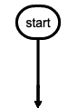
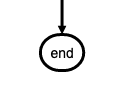
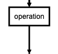
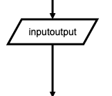
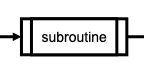
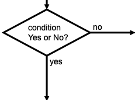
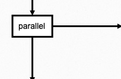

# flowchart.ts

flowchart.ts is modern version of flowchart.js, a flowchart DSL and SVG render that runs in the browser.

Nodes and connections are defined separately so that nodes can be reused and connections can be quickly changed.
Fine grain changes to node and connection style can also be made right in the DSL.

The SVG renderer is implemented in this package, so flowchart.ts has **no runtime dependencies** and targets modern browsers.

## Installation

```bash
pnpm add flowchart.ts
# npm install flowchart.ts
# yarn add flowchart.ts
```

## Usage

```ts
import { parse } from "flowchart.ts";

const chart = parse(`\
st=>start: Start
op1=>operation: My Operation
e=>end: End

st->op1->e
`);

// draw into an element or an element id
chart.draw("diagram");

// remove the rendered SVG again
chart.clean();
```

`parse` accepts the DSL below and returns a `Chart`; `draw(container, options)` renders it as SVG.
Styles can be passed per call (colors, fonts, line width, ...), per symbol type, or per flowstate.

## Requirements

- **ESM-only**: the package ships ES modules (`"type": "module"`, no CommonJS entry); use it with a bundler or an ESM-capable runtime
- Node.js `^22.23.0 || ^24.21.0 || ^26.10.0` (current LTS lines) for development
- any modern browser (SVG + ES2022) at runtime

## Development

```bash
pnpm install      # install dependencies
pnpm dev          # demo page of the examples in `template/`
pnpm build        # build `dist/flowchart.js` and `dist/flowchart.d.ts` with tsdown + publint
pnpm test         # run the vitest suite (happy-dom)
pnpm lint:check   # oxlint + oxfmt
pnpm type-check   # tsc --noEmit
```

## Releasing

Releases are published from CI with npm Trusted Publishing (OIDC), so no long-lived npm token is
stored in the repository.

1. On npmjs.com, add a trusted publisher for `flowchart.ts`:
   - repository: `Mister-Hope/flowchart.ts`
   - workflow: `publish.yml`
   - environment: leave empty
2. Run the **Publish** workflow manually (`workflow_dispatch`) from `main`:
   - `bump`: `patch` / `minor` / `major`, a `pre*` bump, or `none` to only publish the current version
   - `preid`: prerelease identifier (e.g. `beta`) for pre* bumps
   - `dist_tag`: npm dist-tag, e.g. `next` for a prerelease
   - `dryrun`: rehearse without committing, tagging, pushing or publishing
3. The workflow lints, type-checks, tests and builds, bumps the version, commits and pushes the
   release commit + tag, then publishes with provenance through the OIDC token.

A failed publish can be retried without bumping again by running the workflow with `bump = none`.

## Architecture

- `src/parse/` — DSL parsing: `lines.ts` splits/joins input lines, `definition.ts` parses node
  definitions, `flow.ts` applies connections, `style.ts` applies per-line style overrides,
  `draw.ts` builds the display-symbol tree, and `index.ts` exposes `parse()`
- `src/symbols/` — rendered node classes (`start`, `end`, `condition`, `parallel`, ...) and their
  shared helpers: `symbol.ts` holds shape setup and measurement, `line-routing.ts` chooses
  connection paths, `placement.ts` positions child nodes, `crossing.ts` bends lines around
  intersections, and `node-links.ts` binds links/callbacks. `index.ts` is the barrel
- `src/render/` — the in-house SVG renderer: elements, paths, text metrics, arrow markers and the
  paper/set abstractions; no runtime dependencies
- `src/chart.ts` — layout orchestration (symbol alignment, rendering order, viewBox sizing)
- `src/action.ts` — path/line drawing primitives shared by symbols
- `__tests__/` — unit + regression tests. `fixtures/charts.ts` is the DSL corpus and
  `snapshots.spec.ts` snapshots the full rendered DOM and geometry, so layout refactors have to
  keep the output stable; update snapshots with `pnpm test -u` after a deliberate layout change

## Example

```flowchart
st=>start: Start:>http://www.google.com[blank]
e=>end:>http://www.google.com
op1=>operation: My Operation
sub1=>subroutine: My Subroutine
cond=>condition: Yes
or No?:>http://www.google.com
io=>inputoutput: catch something...
para=>parallel: parallel tasks

st->op1->cond
cond(yes)->io->e
cond(no)->para
para(path1, bottom)->sub1(right)->op1
para(path2, top)->op1
```


## Node Syntax

`nodeName=>nodeType: nodeText[|flowstate][:>urlLink]`

Items in `[]` are optional.

_nodeName_ defines the nodes variable name within the flowchart document.

_nodeType_ defines what type the node is. See **Node Types** for more information.

_nodeText_ is the text that will be inserted into the node. Newlines are allowed and will be reflected in the rendered node text.

_flowstate_ is optional and uses the `|` operator that specifies extra styling for the node.

_urlLink_ is optional and uses the `:>` operator to specify the url to link to.

## Node Types

Defines the shape that the node will take.

### start

Used as the first node where flows start from.
Default text is `Start`.



```flowchart
st=>start: start
```

### end

Used as the last node where a flow ends.
Default text is `End`.



```flowchart
e=>end: end
```

### operation

Indicates that an operation needs to happen in the flow.



```flowchart
op1=>operation: operation
```

### inputoutput

Indicates that IO happens in a flow.



```flowchart
io=>inputoutput: inputoutput
```

### subroutine

Indicates that a subroutine happens in the flow and that there should be another flowchart that documents this subroutine.



```flowchart
sub1=>subroutine: subroutine
```

### condition

Allows for a conditional or logical statement to direct the flow into one of two paths.



```flowchart
cond=>condition: condition
Yes or No?
```

### parallel

Allows for multiple flows to happen simultaneously.



```flowchart
para=>parallel: parallel
```

## Connections

Connections are defined in their own section below the node definitions.
The `->` operator specifies a connection from one node to another like `nodeVar1->nodeVar2->nodeVar3`.

Not all nodes need to be specified in one string and can be separaged like so

```flowchart
nodeVar1->nodeVar2
nodeVar2->nodeVar3
```

Connection syntax is as follows:

`<node variable name>[(<specification1>[, <specification2])]-><node variable name>[[(<specification1>[, <specification2])]-><node variable name>]`

Items in `[]` are optional.

### Directions

The following directions are available and define the direction the connection will leave the node from. If there are more than one specifiers, it is always the last. All nodes have a default direction making this an optional specification. `<direction>` will be used to indicate that one of the following should be used in its place.

- left
- right
- top
- bottom

### Node Specific Specifiers by Type

Each node variables has optional specifiers, like direction, and some have special specifiers depending on the node type that are defined below. Specifiers are added after the variable name in `()` and separated with `,` like `nodeVar(spec1, spec2)`.

### start

Optional direction

`startVar(<direction>)->nextNode`

### end

No specifications because connections only go to the end node and do not leave from it.

`previousNode->endVar`

### operation

Optional direction

`operationVar(<direction>)->nextNode`

### inputoutput

Optional direction

`inputoutputVar(<direction>)->nextNode`

### subroutine

Optional direction

`subroutineVar(<direction>)->nextNode`

### condition

Required logical specification of `yes` or `no`

Optional direction

```flowchart
conditionalVar(yes, <direction>)->nextNode1
conditionalVar(no,  <direction>)->nextNode2
```

### parallel

Required path specification of `path1`, `path2`, or `path3`

Optional direction

```flowchart
parallelVar(path1, <direction>)->nextNode1
parallelVar(path2, <direction>)->nextNode2
parallelVar(path3, <direction>)->nextNode3
```

## Links

A external link can be added to a node with the `:>` operator.

The `st` node is linked to `http://www.google.com` and will open a new tab because `[blank]` is at the end of the URL.

The `e` node is linked to `http://www.yahoo.com` and will cause the page to navigate to that page instead of opening a new tab.

```flowchart
st=>start: Start:>http://www.google.com[blank]
e=>end: End:>http://www.yahoo.com
```

## Advice

Symbols that should possibly not be used in the text: `=>` and `->` and `:>` and `|` and `@>` and `:$`

If you want to emphasize a specific path in your flowchart, you can additionally define it like this:

```
st@>op1({"stroke":"Red"})@>cond({"stroke":"Red","stroke-width":6,"arrow-end":"classic-wide-long"})@>c2({"stroke":"Red"})@>op2({"stroke":"Red"})@>e({"stroke":"Red"})
```

## Custom names for branches

```
st=>start: Start:>http://www.google.com[blank]
e=>end:>http://www.google.com
op1=>operation: My Operation
sub1=>subroutine: My Subroutine
cond=>condition: linear or polynomial :>http://www.google.com
io=>inputoutput: catch something...
para=>parallel: 3 possibilities

st->op1->cond
cond(true@linear)->io->e
cond(false@polynomial)->sub1(right)
sub1(right)->para
para(path1@an1, top)->cond
para(path2@an2, right)->op1
para(path3@an3, bottom)->e
```

<details>

  <summary>Demonstration</summary>


</details>
